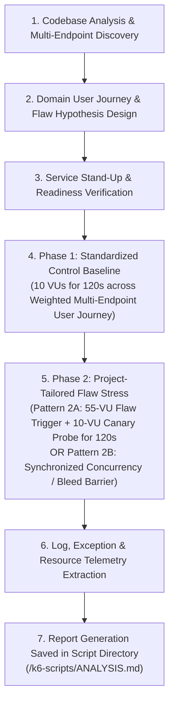

# K6 Load Tester

This skill automates performance quality assurance, comparable baseline load testing, and code-informed structural flaw verification for service-based applications using k6.

It enforces a **strict, scientifically comparable 2-phase execution strategy**:
1. **Phase 1 — Standardized Control Baseline (`01_deterministic_standard_profiles.js`)**: Executes a uniform, non-destructive **10-VU, 120-second (`2m`) steady-state baseline** across a probabilistic weighted multi-endpoint user journey (4–6 domain routes, `sleep(0.1)` pacing). Phase 1 acts as the **experimental control group** and must never include high-VU spikes or destructive stress bursts that prematurely trigger flaws.
2. **Phase 2 — Project-Tailored Flaw Stress & Isolation (`02_specialized_stress.js`)**: Inspects source code for specific anti-patterns matching the **Structural Flaw Taxonomy**, and executes a tailored **60–65 VU, 120-second stress profile** using either **Pattern 2A (Dual-Scenario Flaw Trigger + Canary Latency Probe)** or **Pattern 2B (Synchronized Concurrency / Context Bleed Barrier)** to empirically isolate and prove the flaw.

---

## Standardized Workflow

### 1. Codebase Analysis & Multi-Endpoint Discovery
- **Spring Boot / Java / Scala / Groovy**: Search for `@RestController`, `@Controller`, `@RequestMapping`, `@GetMapping`, `@PostMapping`, servlet `Filter` chains, and DAO/MyBatis/JPA queries.
- **Python / Node.js / Go**: Parse Express, Flask/FastAPI, Gin/Fiber routes and request handlers.
- **Entry Point Mapping**: Discover 4–6 representative functional routes (authentication, list browsing, item detail views, search/filtering, and lightweight creation/status checks) plus specific endpoints containing structural flaws.
- **Configuration Inspection**: Read application properties/YAML for server port (`server.port`), connection pools (`hikari.maximum-pool-size`, `druid.max-active`), thread pools (`server.tomcat.threads.max`, Quartz/async pools), and timeouts.

### 2. Phase 1: Standardized Control Baseline (`01_deterministic_standard_profiles.js`)
Phase 1 MUST be comparable across all benchmarked projects:
- **Fixed Load Envelope**: **10 VUs for 120 seconds** (`10s` ramp to `10 VUs` $\rightarrow$ `100s` steady at `10 VUs` $\rightarrow$ `10s` ramp-down to `0 VUs`). **Do NOT put 50–100 VU spike stages inside Phase 1.**
- **Probabilistic Single-Request Branching**: Use `const rand = Math.random()` inside `export default function()` so each VU iteration executes **one** weighted endpoint (e.g., 40% list browse, 25% item detail, 20% search/query, 15% light write/metadata) rather than chaining 10 sequential calls in a single iteration.
- **Uniform Think-Time Pacing**: Use `sleep(0.1)` at the end of each iteration so baseline throughput (`req/s`) and latency percentiles ($p50, p90, p95, \max$) are directly comparable across projects.
- **STRICT DIRECTIVE**: **NEVER restrict load tests to a single `/health` endpoint**, and **NEVER overload Phase 1 with high concurrency that causes baseline failures.**

### 3. Phase 2: Project-Tailored Flaw Stress (`02_specialized_stress.js`)
Craft a custom Phase 2 script tailored to the exact architectural flaw uncovered in the codebase, matching the **120-second (`2m`)** test window (except for instantaneous barrier race tests):
- **Pattern 2A — Dual-Scenario Flaw Trigger + Canary Probe (`Flaws 1.3–1.4, 2.1–2.4, 3.1, 3.2b, 3.3, 4.1–4.3, 5.1–5.2, 6.1–6.2`)**:
  - **`flaw_trigger` scenario (`55 VUs`, `120s` ramping/steady, `sleep(0.02)`)**: Concentrates traffic and flaw-amplifying payloads directly on the vulnerable code path (e.g., complex regexes, unindexed leading-wildcard `LIKE '%a%'`, `_revinclude` / N+1 graph queries, synchronous file/DB locks, heavy batch/export allocations, unbounded event-store registrations, or reactive `.flatMap()` fan-outs).
  - **`canary_probe` scenario (`10 VUs` or `constant-arrival-rate: 10/s`, `120s`)**: Concurrently probes a fast, non-contended baseline endpoint (e.g., `/health`, `/login`, `/api/registry`, or fast metadata GET) with tagged metrics (`tags: { name: 'CanaryProbe' }`) to prove both **local flaw degradation** and **cross-endpoint collateral starvation**.
- **Pattern 2B — Synchronized Concurrency / State Isolation Barrier (`Flaws 1.1, 1.2, 3.2a`)**:
  - **Check-Then-Act & Optimistic Lock Collisions (`Flaw 1.2`, `Flaw 3.2a`)**: Use `per-vu-iterations` (`30–60 VUs`) or high-concurrency `ramping-vus` (`65 VUs`) simultaneously mutating the **exact same shared entity ID** (`couponId`, `taskId`, `executionId`, or inventory SKU) to maximize race/abort collisions, paired with a `canary_probe` scenario.
  - **`ThreadLocal` Context Bleed (`Flaw 1.1`)**: Pair `55 VUs` executing authenticated/tenant-scoped requests with `10 VUs` executing unauthenticated or cross-tenant/missing-header security probes on the shared worker thread pool to assert context isolation (`check()` failure rate).

### 4. Raw Result Export, Telemetry & Log Extraction
- **Raw Execution Results**: Every `k6` execution run MUST export its raw metrics JSON file directly into `k6-scripts/`:
  - `k6-scripts/01_standard_summary.json`
  - `k6-scripts/02_specialized_summary.json`
- **Log & Container Telemetry Extraction**: Capture container CPU %, resident memory (`MiB`/`GiB`), active thread count, disk I/O volume, and server log stack traces (`SQLTransientConnectionException`, `FlowableOptimisticLockingException`, `AllNodesFailedException`, `IOException: Broken pipe`, `OutOfMemoryError`).

### 5. Script Directory Report & Synthesis Rules
- **Mandatory Report File Location**: Save the complete analysis report at **`<project-root>/k6-scripts/ANALYSIS.md`**.
- **Empirical Findings Summary Directives**: `ANALYSIS.md` MUST present a clear **Phase 1 (10-VU Baseline) vs. Phase 2 (Tailored Flaw Stress)** comparison table with exact quantitative metrics (`http_reqs`, `req/s`, avg, $p50$, $p90$, $p95$, max latencies, HTTP failure rates/counts, canary probe latency degradation, CPU/RAM/Disk telemetry, and server stack traces) alongside exact source code snippets and line numbers.
- **Master Summary Integration**: Synthesize findings into `thesis/projects/ANALYSIS_SUMMARY.md`.

---

## Reference Guides

- **Traffic Shaping & Load Profiles**: See `references/profiles.md` for the exact Phase 1 (10-VU 120s baseline) and Phase 2 (Pattern 2A Dual-Scenario & Pattern 2B Concurrency Barrier) k6 templates.
- **Taxonomy Verification Strategies**: See `references/taxonomy-verification.md` for specialized test design matching all taxonomy flaws.
- **Execution Orchestration**: See `references/workflow.md` for step-by-step execution and report placement rules.
